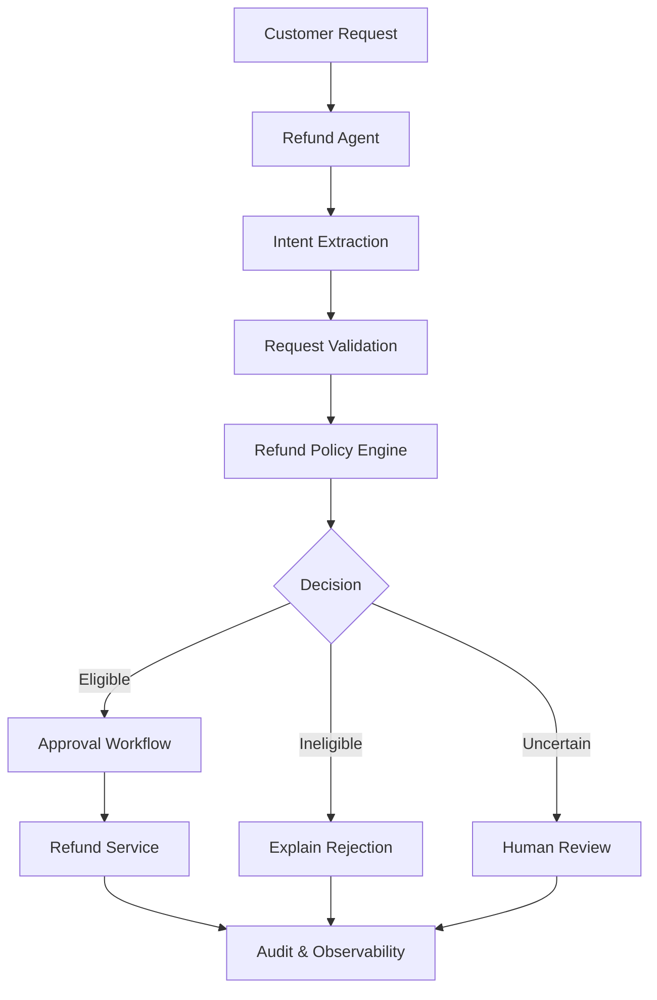

# 🦀 Refund Agent — AI-Powered Refund Automation in Rust

<p align="center">
  A type-safe, policy-driven AI agent for handling customer refund requests.
</p>

<p align="center">
  
  
  
  
</p>

---

## 🎯 Overview

**Refund Agent** is a learning and portfolio project focused on building a reliable AI agent in Rust, evolving from a simple application into a production-oriented system.

The agent is designed to interpret customer refund requests, retrieve order information, evaluate refund eligibility against deterministic business policies, and coordinate appropriate actions.

The project emphasizes **type safety, explicit error handling, testability, security, and observable agent behavior**.

> The long-term goal is to demonstrate how AI-powered automation can be combined with deterministic business rules and human oversight.

## ✨ Key Features

- 🦀 **Rust-first design** — strong types, ownership, and explicit error handling.
- 📦 **Domain modeling** — customers, orders, refund requests, and decisions.
- ⚖️ **Deterministic refund policies** — business rules remain separate from LLM reasoning.
- 🤖 **LLM-powered intent extraction** — planned natural-language understanding.
- 🛡️ **Guardrails and authorization** — planned controls for sensitive actions.
- 🧪 **Automated testing and evaluations** — validate behavior and prevent regressions.
- 📊 **Observability** — planned structured logging, tracing, and execution metrics.
- 🚀 **Production engineering** — planned API, persistence, containerization, and CI.

*Note: Features are introduced incrementally. Consult the implementation roadmap below to distinguish completed work from planned capabilities.*

## 🏗️ Architecture



### Design Principles

- **Deterministic decisions:** LLM output does not override refund policies.
- **Separation of concerns:** domain models, policies, orchestration, and infrastructure remain distinct.
- **Explicit failure handling:** errors are represented and propagated rather than silently ignored.
- **Human oversight:** uncertain or sensitive decisions can be escalated for review.
- **Testability:** core business rules should be testable without external APIs.

## 🛠️ Built With

| Technology | Purpose |
|---|---|
| [Rust](https://www.rust-lang.org/) | Core programming language |
| [Cargo](https://doc.rust-lang.org/cargo/) | Dependency management and builds |
| [rustfmt](https://rust-lang.github.io/rustfmt/) | Code formatting |
| [Clippy](https://doc.rust-lang.org/clippy/) | Static linting |
| Rust test framework | Unit and integration tests |
| [Serde](https://serde.rs/) | Planned serialization and structured data |
| [Tokio](https://tokio.rs/) | Planned asynchronous execution |
| [Reqwest](https://docs.rs/reqwest/) | Planned HTTP and LLM API integration |
| [Axum](https://github.com/tokio-rs/axum) | Planned HTTP API |
| Docker | Planned containerization |
| GitHub Actions | Planned continuous integration |

## 📂 Project Structure

```text
refund-agent/
├── Cargo.toml
├── Cargo.lock
├── rust-toolchain.toml
├── .gitignore
├── README.md
├── LOG.md
├── src/
│   ├── main.rs
│   ├── lib.rs
│   └── models.rs
├── tests/
├── evals/
└── Dockerfile
```

The repository will expand as the agent gains policy evaluation, workflow orchestration, LLM integration, testing infrastructure, and production capabilities.

## 🚀 Getting Started

### Prerequisites

- Rust stable toolchain
- Cargo
- Git

Install Rust using the [official installation guide](https://www.rust-lang.org/tools/install).

### Clone the Repository

```bash
git clone <YOUR_REPOSITORY_URL>
cd refund-agent
```

Replace `<YOUR_REPOSITORY_URL>` with your actual GitHub repository URL.

### Run the Application

```bash
cargo run
```

### Run Tests

```bash
cargo test
```

### Check Formatting

```bash
cargo fmt --check
```

### Run Clippy

```bash
cargo clippy --all-targets -- -D warnings
```

## 🧪 Example Use Case

**Customer request**

> My order arrived damaged. Can I get a refund?

**Intended processing flow**

1. Extract the refund intent and relevant order information.
2. Validate the request and retrieve the order.
3. Evaluate eligibility against refund policies.
4. Approve, reject, or escalate the request.
5. Execute authorized actions and record the outcome.

**Illustrative decision**

```json
{
  "order_id": "ORD-1001",
  "decision": "requires_human_review",
  "reason": "Damage evidence must be reviewed"
}
```

This is an illustrative target behavior, not a claim that the complete workflow is already implemented.

## 🗺️ Development Roadmap

- [x] Step 1 — Initialize Rust project and development tooling
- [x] Step 2 — Define refund domain models
- [ ] Step 3 — Implement domain errors and typed error handling
- [ ] Step 4 — Implement deterministic intent classification
- [ ] Step 5 — Build the refund policy engine
- [ ] Step 6 — Implement refund workflow orchestration
- [ ] Step 7 — Define tool and service interfaces
- [ ] Step 8 — Build the agent orchestrator
- [ ] Step 9 — Add approval and escalation workflows
- [ ] Step 10 — Add integration tests
- [ ] Step 11 — Configure environment variables
- [ ] Step 12 — Integrate an LLM provider
- [ ] Step 13 — Extract structured intent
- [ ] Step 14 — Implement validated tool calling
- [ ] Step 15 — Add guardrails, retries, and fallback behavior
- [ ] Step 16 — Build evaluation datasets
- [ ] Step 17 — Implement evaluation runners
- [ ] Step 18 — Define evaluation thresholds
- [ ] Step 19 — Add observability and reliability
- [ ] Step 20 — Implement security and execution budgets
- [ ] Step 21 — Add persistent storage
- [ ] Step 22 — Expose HTTP API endpoints
- [ ] Step 23 — Add authentication and authorization
- [ ] Step 24 — Add Docker and CI
- [ ] Step 25 — Complete the production capstone

Progress and implementation decisions are tracked in [`LOG.md`](LOG.md).

## 📐 Engineering Standards

The project aims to maintain the following standards:

- Consistent formatting and strict linting.
- Unit and integration tests for business-critical behavior.
- Explicit handling of invalid input and infrastructure failures.
- No direct refund execution without required authorization.
- Evaluation-based validation of LLM behavior.
- Secure configuration and secret management.
- Documented architectural decisions and trade-offs.

## 🎓 Learning Objectives

This project explores the engineering disciplines required to build AI agents beyond a basic LLM call:

- Rust ownership, borrowing, structs, enums, and traits.
- Domain-driven modeling and business rule isolation.
- Error handling and resilient service integration.
- LLM orchestration and structured output validation.
- Tool calling, guardrails, and human-in-the-loop workflows.
- Evaluation design, observability, and production deployment.

## 🤝 Contributing

This repository is primarily a structured learning project. Suggestions, bug reports, and improvements are welcome.

See [`CONTRIBUTING.md`](CONTRIBUTING.md) for contribution guidelines once the file is added.

## 📄 License

This project is licensed under the MIT License. See [`LICENSE`](LICENSE) for details once the license file is added.

---

<p align="center">
  <strong>Built with Rust 🦀 and a focus on reliable AI engineering.</strong>
</p>